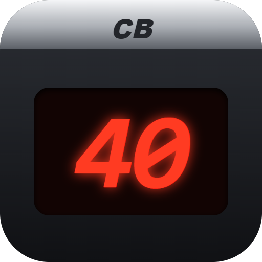

# Breaker 40 CB

A 40-channel CB radio for Windows and Linux. Pick a channel, hold the mic button (or the Space bar), and talk to everyone else on that channel who is running the app.



## Downloads

Get them from the [Releases page](https://github.com/devliquid/cb-radio/releases/latest).

| File | What it is |
|---|---|
| `Breaker40-CB-Setup-<version>.exe` | Windows: the radio, as an installer |
| `Breaker40-CB-Portable-<version>.exe` | Windows: the radio as one file that runs without installing |
| `Breaker40-BaseStation.exe` | Windows: the base station |
| `Breaker40-CB-<version>-linux-x86_64.AppImage` | Linux: the radio as one file for any distro (`-arm64` for ARM) |
| `breaker40-cb_<version>_amd64.deb` | Linux: the radio for Ubuntu, Debian and Mint (`_arm64` for ARM) |
| `Breaker40-BaseStation-linux-x64` | Linux: the base station (`-arm64` for ARM, such as a Raspberry Pi 4 or 5 on a 64-bit OS) |

**On Linux:**
- **AppImage:** run `chmod +x Breaker40-CB-*.AppImage`, then double-click it or run `./Breaker40-CB-*.AppImage`. If it says FUSE is missing, install it (`sudo apt install libfuse2t64`, or `libfuse2` on Ubuntu 22.04 and older), or run it with `--appimage-extract-and-run`.
- **.deb:** run `sudo apt install ./breaker40-cb_*.deb`. It shows up in the app menu as Breaker 40 CB, or you can run `breaker40-cb` from a terminal. It installs to `/opt/Breaker40CB`.
- **Base station:** run `chmod +x Breaker40-BaseStation-linux-x64`, then `./Breaker40-BaseStation-linux-x64`. It works the same as the Windows exe (see [The base station exe](#the-base-station-exe)). Ports below 1024 need root, so stick to ports like 7140.

## What's on the radio

| Control | What it does |
|---|---|
| **CHANNEL** knob | Channels 1–40, with the real CB frequencies. Drag it, scroll it, or use the arrow keys. |
| **VOLUME** | Speaker volume. |
| **SQUELCH** | Turn it all the way down to hear open-band static. Turn it up for silence between transmissions. |
| **PUSH TO TALK** | Hold to talk. Holding **Space** does the same. Like a real rig, you can't hear while you're keyed up, and the mic unkeys after 3 minutes. |
| **CH 9 / CH 19** | Jump to the emergency channel or the highway channel. |
| **SCAN** | Sweeps the band and stops on any channel where someone is talking. |
| **ROGER** | Sends a roger beep when you let go of the mic. |
| **ECHO** and slider | Echo mic: everyone on the channel hears your voice repeat. The slider sets how much, from a light slap to a long, ringing echo. Moving it turns echo on. You don't hear your own echo, just like with a real echo mic. |
| Meter | S-meter on receive, RF power on transmit. |
| Band strip | All 40 channels: green means people are listening, red means someone is talking. Click one to tune to it. |
| **SETUP** | Everything you can change. See below. |

## SETUP

Each PC keeps its own settings, and they're still there after a restart.

- **Your handle:** the name others see when you talk.
- **Saved base stations:** the list starts with **Render (hosted)**, the hosted base station. To add another, type an address, give it a name ("My server", "Home LAN") and click **Save to list**. Picking a station from the list connects to it straight away. **Delete** removes the selected one.
- **Base station address:** starts out as the hosted base station, `wss://breaker40-base-station.onrender.com`, so a new install is on the air right away. To use another one, enter `ws://ip:port`, `wss://domain`, just a domain name (the app adds `wss://`), or just an IP (the app adds port 7140), and click **Connect**.
- **Be the base station:** run the relay on this PC, on any port.
- **Microphone / Speaker:** choose devices, or leave them on Windows default. If a chosen device is unplugged, the app falls back to the default.
- **Mic level and Mic gain:** talk normally and adjust the gain until the level bar sits in the green, below the dashed line. That's the level other people will hear.
- **Push-to-talk key:** click **Change…** and press any key. Esc cancels. Tab and Enter can't be used because they move around the window.

## How people find each other

Every copy of the app connects to one **base station** (a small relay server). Everyone using the same base-station address can hear each other.

**The easy way:** do nothing. Every radio starts out connected to the hosted base station at `wss://breaker40-base-station.onrender.com`, so everyone who installs the app can already hear each other. Radios updated from 1.0.2 or earlier that still had the old default (`ws://localhost:7140`) move to it too, unless that PC is hosting.

**On the same Wi-Fi or LAN:** one person opens SETUP and ticks **Host on port 7140**. The app lists addresses such as `ws://192.168.1.20:7140`. Everyone else enters that address and clicks **Connect**. Allow the app through the Windows Firewall if Windows asks.

**Over the internet, from your own PC:** host as above, then forward TCP port 7140 on your router to that PC. Friends connect to `ws://YOUR-PUBLIC-IP:7140`.

**On your own Windows server: Breaker40-BaseStation.exe.** This is the relay as one file that needs nothing installed. Copy it to the server and double-click it. A console window opens showing the addresses people should enter, plus a line each time someone joins, leaves or changes channel. See [The base station exe](#the-base-station-exe).

**Over the internet, always on, without a Windows server:** deploy the `server/` folder to any Node host that supports WebSockets, such as Render, Railway, Fly.io or a small VPS.
- Render: the repo has a `render.yaml` blueprint, so setup is a few clicks. See [Hosting the base station on Render](#hosting-the-base-station-on-render).
- On a Linux server, use `Breaker40-BaseStation-linux-x64` from the Releases page. Or, if Node is installed, run `npm install` in the `server` folder, then `node relay.js`. Both use the same settings file, flags and typed menu as the exe.

To make a different address the one every new install starts with, change `server:` in `DEFAULTS` at the top of `renderer/app.js` and rebuild.

## Hosting the base station on Render

[Render](https://render.com) runs the base station for you, always on, with a secure `wss://` address and nothing to forward on your router.

1. In the Render dashboard, click **New** > **Blueprint**.
2. Connect your GitHub account if Render asks, and pick the `cb-radio` repository (your own fork works too).
3. Render reads `render.yaml` and shows one web service, **breaker40-base-station**. Click **Apply**.
4. When the deploy finishes, the service page shows its address, such as `https://breaker40-base-station.onrender.com`. The log also prints the address to use in the radio.
5. In each radio's SETUP, enter `wss://breaker40-base-station.onrender.com` (or just `breaker40-base-station.onrender.com`; the app adds `wss://`), click **Connect**, and **Save to list** it if you like.

If that service name is already taken, Render adds a few letters to the address. Use the address your service page shows.

Things to know about the free plan:

- It goes to sleep when nobody has used it for about 15 minutes. The first person to connect after that waits up to a minute while it wakes. The radio keeps retrying on its own, so just leave it on.
- Everyone is briefly disconnected whenever Render redeploys or restarts the service. The radios reconnect by themselves.
- A paid instance stays awake all the time. Change `plan: free` in `render.yaml`, or change the instance type on the service's settings page.

Render redeploys automatically when something in `server/` changes on `main`. Changes to the radio app alone don't trigger a redeploy.

## The base station exe

`Breaker40-BaseStation.exe` listens on **port 7140** on **every network of the machine** (`0.0.0.0`) unless you change it. There are three ways to change the settings:

1. **While it's running:** type `s` and press Enter. It asks for the port (Enter keeps the current one), then lists the IP choices:
   - `0.0.0.0`: every network on the machine. This is the usual choice.
   - `127.0.0.1`: this machine only, for testing.
   - Each of the machine's own addresses, to listen on just that network.

   It saves your choices and restarts on the new settings. Other commands: `r` restarts, `i` shows the addresses again, `q` quits.
2. **The settings file:** `relay-settings.json` sits next to the exe and is created on first run:
   ```json
   { "port": 7140, "ip": "0.0.0.0" }
   ```
   Edit it and restart the exe. If the exe's folder is read-only, the file goes in `%APPDATA%\Breaker40BaseStation\` instead.
3. **Command-line flags,** handy for a shortcut or a scheduled task:
   ```powershell
   .\Breaker40-BaseStation.exe --port 7155 --ip 0.0.0.0
   .\Breaker40-BaseStation.exe --port 7155 --save    # also write it to the settings file
   ```
   The `PORT` and `HOST` environment variables work too. Flags win over environment variables, and environment variables win over the file.

If the port is taken, or the IP isn't one of the machine's own, the exe explains what's wrong and asks for new settings.

The first time it runs, Windows Firewall asks whether to allow it. Allow it on the networks people will connect from. For people outside your network, forward the port on your router to the server.

To run it with no one logged in, start it at boot with Task Scheduler ("Run whether user is logged on or not") using the flags above. With no console attached it skips the typed menu and just runs.

**On Linux,** the settings file sits next to `Breaker40-BaseStation-linux-x64` the same way, and the flags are the same. To open the port in the firewall on Ubuntu, run `sudo ufw allow 7140/tcp`. To keep it running at boot, save this as `/etc/systemd/system/breaker40.service` (change the path and user to yours):

```ini
[Unit]
Description=Breaker 40 CB base station
After=network-online.target
Wants=network-online.target

[Service]
ExecStart=/opt/breaker40/Breaker40-BaseStation-linux-x64 --port 7140 --ip 0.0.0.0
User=breaker40
Restart=on-failure

[Install]
WantedBy=multi-user.target
```

Then run `sudo systemctl enable --now breaker40`, and use `journalctl -u breaker40 -f` to watch who joins.

## Building

```powershell
npm install
npm start          # run it
npm test           # relay server checks
npm run dist       # builds dist\Breaker40-CB-Portable-1.0.0.exe and dist\Breaker40-CB-Setup-1.0.0.exe
npm run dist:relay # builds the base station for this platform (dist\Breaker40-BaseStation.exe on Windows)
npm run dist:all   # all three Windows files
npm run test:exe   # checks the base station exe (build it first)
npm run server     # run a base station without the radio window
npm run dist:linux # on Linux: builds the AppImage and .deb
```

**Linux builds** come from GitHub Actions (`.github/workflows/linux.yml`), because electron-builder can't make Linux packages on Windows. Every push to `main` builds the x64 and arm64 versions on GitHub's Linux machines. It runs the relay and base station tests, then opens the AppImage and the .deb with a fake mic, checks they connect to a base station, and takes a screenshot. The files and screenshots are on the run's page under **Artifacts**.

To put the Linux files on a release, push a `v*` tag after creating the release. Or run the workflow by hand (**Actions → Linux build → Run workflow**) and enter the release's tag.

Notes:
- If `npm start` says Electron failed to install, unpack `%LOCALAPPDATA%\electron\Cache\...\electron-v33.4.11-win32-x64.zip` into `node_modules\electron\dist` and create `node_modules\electron\path.txt` containing `electron.exe`.
- If `npm run dist` fails with "Cannot create symbolic link", run it once from an Administrator terminal, or turn on Windows Developer Mode.

## How it works

- `main.js`: the Electron window, plus the built-in base station when you host.
- `server/server.js`: the relay. It tracks who is on which channel, passes audio only to people on the same channel, and broadcasts the band activity.
- `server/relay.js`: the stand-alone base station around it: the settings file, flags, console status and typed menu.
- `build/build-relay.js`: bundles `relay.js` with esbuild and wraps it in Node's single-executable format to make the base station exe.
- `renderer/`: the radio itself. Your voice is sent as 8 kHz mono audio, about 16 KB/s while you talk. Incoming audio goes through a band-pass filter, light distortion and static to sound like AM CB.

There is no account system or encryption. Anyone with the base-station address can listen and talk, just like real CB.
